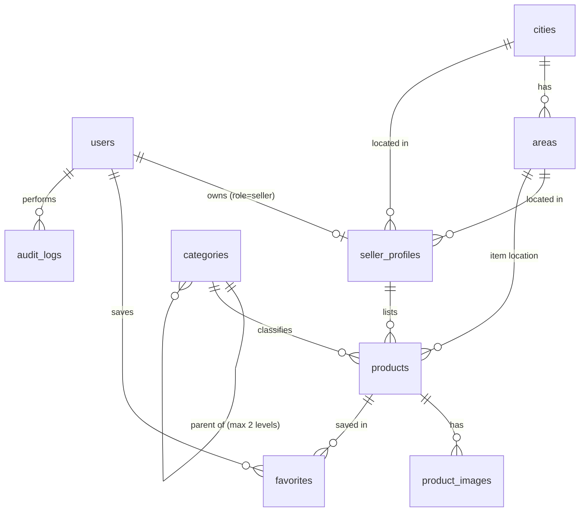
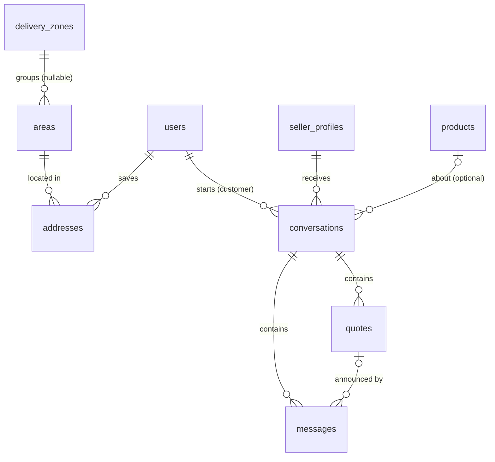

# Architecture

## Overview

```
React SPA (frontend/)  --HTTPS, Bearer token-->  Laravel API (backend/, /api/*)  -->  MySQL
                                                       |
                                                       +--> public disk (product photos)
```

- The API is the only place permissions are enforced. Frontend role checks only hide navigation.
- Authentication: Laravel Sanctum personal access tokens (30-day expiry), sent as `Authorization: Bearer`. One token per sign-in; sign-out revokes it.
- Money: every amount is stored as integer **santim** (1 ETB = 100 santim) in `*_santim` columns. The API accepts and returns birr strings (`"12500.50"`) and also returns the santim integer. No floats touch stored money.

## Roles

| Role | How it is assigned | Can |
|---|---|---|
| guest | not signed in | browse published listings, storefronts, categories |
| customer | `POST /api/auth/register` | wishlist, delivery addresses, inquiries to sellers, accept or decline quotes (orders and reviews in later milestones) |
| seller | `POST /api/auth/register-seller` creates the account and a **pending** store | drafts while pending; submit listings once approved; answer inquiries and send quotes; only ever sees own records |
| admin | `php artisan marketplace:create-admin` only | approve/reject/suspend sellers, moderate listings, manage categories and delivery zones, audit log. Admins cannot read private conversations |
| delivery | reserved for a later milestone | |

`role` and `status` are not mass-assignable, so no API payload can change them.

## Schema (milestone 1)



| Table | Key columns and constraints |
|---|---|
| users | email unique (stored lowercase), role (customer/seller/admin/delivery), status (active/suspended), bcrypt password |
| cities, areas | Addis Ababa + 11 sub-cities seeded; `areas (city_id, slug)` unique. Adding a city later is data, not code |
| seller_profiles | user_id unique FK; slug unique and stable after renames; status pending/approved/rejected/suspended; reviewed_by/at; TIN optional |
| categories | slug unique, parent_id (two levels), is_active, sort_order. Admin-managed |
| products | seller_profile_id FK, category_id FK, price_santim, condition, stock_type (in_stock/made_to_order), stock_quantity, production_days, dimensions cm, material, color, delivery fields, status, moderation_note, soft deletes. Indexes on (status, category_id), (status, price_santim), (status, published_at), (seller_profile_id, status) |
| product_images | product_id FK cascade, random file names under `products/{id}/` |
| favorites | (user_id, product_id) unique |
| audit_logs | append-only: user, action, subject, JSON meta, IP |

### Added in milestone 2



| Table | Key columns and constraints |
|---|---|
| delivery_zones | name unique, fee_santim, min_days, max_days, notes, is_active. `areas.delivery_zone_id` nullable, set null when a zone is deleted |
| addresses | user_id cascade, area_id restrict, recipient_name, phone, address_line, landmark, is_default. Max 10 per user, exactly one default while any exist |
| conversations | customer_id, seller_profile_id (restrict), product_id nullable, type (question/availability/negotiation/custom_request), status open/closed, last_message_id, customer_last_read_id, seller_last_read_id |
| messages | conversation_id cascade, sender_id, body (max 2000), quote_id nullable. Append-only, no edits |
| quotes | conversation_id, seller_profile_id, title, description, price_santim, quantity, delivery_fee_santim nullable, production_days, valid_until, status pending/accepted/declined/withdrawn |

Foreign keys use `restrict` where deleting the parent would destroy history (sellers, categories, cities) and `cascade` only for pure child rows (images, favorites).

## Business rules implemented

**Public visibility.** A listing is public only when it is `published`, not soft-deleted, its category is active, its seller is `approved`, and the seller's user account is `active`. Suspending a seller or deactivating a category hides their listings immediately without changing listing data, so reinstating restores them.

**Seller lifecycle.** pending -> approved | rejected; approved -> suspended -> approved (reinstate); rejected -> approved. Reject and suspend require a reason the seller sees. Transitions run under a row lock and are audited.

**Listing lifecycle.**
- Create as `draft` (any pending or approved seller) or submit straight to `pending_review` (approved sellers, at least one photo).
- Admin approves `pending_review` -> `published` (seller must be approved, listing must have a photo) or rejects with a note. Published listings can also be taken down with a note.
- Editing name, description, category, material or condition of a published listing sends it back to `pending_review` (`MARKETPLACE_REAPPROVE_ON_EDIT`). Price, stock and delivery edits go live immediately.
- `archived` hides a listing; resubmitting sends it to review. Delete is a soft delete so future order history keeps its product rows.
- Made-to-order items carry production days and no stock count; in-stock items carry a count and no production days. Every listing offers delivery, pickup, or both.

**Inquiries (Method B).**
- Only customer accounts start inquiries, about a visible listing or a visible store. Seller and admin accounts cannot.
- Allowed types follow the seller's settings: price offers only on listings marked negotiable, custom requests only where the listing or store accepts custom orders, availability and price offers only about a listing.
- A second inquiry about the same listing while a thread is open is added to that thread instead of opening a duplicate (serialised with a row lock).
- Either side can close a thread. Closed threads stay readable but take no new messages or quotes.
- When a store is suspended, both sides keep read access to history but nobody can write.
- Unread state is tracked by message id per side, not by timestamp, so two messages in the same second are never missed. Sending a message marks the thread read for the sender.
- Outsiders get 404 on every conversation and quote endpoint.
- Rate limits: 10 new inquiries per hour and 30 per day per customer; 20 messages per minute and 500 per day per user.

**Quotes.**
- Only the conversation's seller sends quotes. A new quote withdraws the seller's earlier pending quote in that thread, so the customer can only accept the latest terms.
- Validity is at most 60 days and inclusive of the last day. Expiry is derived from `valid_until` and never stored, so there is no cron job to forget.
- Accept, decline and withdraw run under row locks (conversation, then quote, the same order quote creation uses) and succeed exactly once. Verified with parallel requests against MariaDB.
- Accepting needs an open thread and an active store. Declining and withdrawing always work.
- Closing a thread ends any pending quote: declined when the customer closes, withdrawn when the seller closes.
- An accepted quote is an agreement in the thread only. It becomes an order when checkout ships (milestone 3).

**Delivery fees.**
- Admins group sub-cities into delivery zones with a default fee and day range.
- The estimate for a listing and sub-city uses the listing's own fee first (0 means free), then the zone fee, else "the seller confirms the fee before you pay". Made-to-order production days are added to the day range.
- Inactive zones are ignored. Deleting a zone leaves its sub-cities unassigned.
- `DemoSeeder` creates three demo zones with made-up fees. Real fees are a business decision set in Admin > Delivery.

**Ownership.** All seller endpoints look records up through the signed-in seller's own profile, so another seller's id returns 404 (no existence leak). Tests cover show, update, delete, submit, archive, image upload and image delete across sellers.

## Security measures in place

- bcrypt password hashing; minimum 8 characters with letters and numbers (12 + symbols for admins).
- Login: constant-time path for unknown emails, 5 attempts per minute per email+IP and 20 per IP. Registration 10 per hour per IP. Uploads 30 per minute per user. Catalog 120 per minute.
- Validation on every write; LIKE search input is escaped; all queries use bindings.
- Mass assignment restricted with explicit fillable lists; strict model mode in non-production to catch silently dropped attributes and lazy loading.
- Uploads: content-checked images only (jpg, png, webp; no SVG), 5 MB, 200 to 8000 px, max 8 per listing enforced under a row lock, stored under random names.
- API 404s never reveal model names; 500s never return server messages to the UI.
- CORS limited to `CORS_ALLOWED_ORIGINS`. Bearer tokens mean CSRF does not apply to the API; there are no cookie-authenticated API routes.
- Audit log for seller applications and reviews, listing create/update/submit/archive/delete/moderation, category changes, quotes (sent, accepted, declined, withdrawn), delivery zone changes and CLI admin creation.

## Decisions and defaults (change if the business decides otherwise)

| Decision | Default chosen | Why |
|---|---|---|
| Token storage | `localStorage` | Simple and works across domains. Trade-off: an XSS bug could read the token. Moving to Sanctum cookie auth on a shared domain is the hardening step before launch |
| One role per account | seller accounts are separate from customer accounts | Simplest correct permission model; sellers can still browse and save favorites |
| Moderation on edit | content fields only | Avoids blocking sellers from updating price and stock while still catching bait-and-switch content |
| Brand name | "Betoch Furniture" via `MARKETPLACE_NAME` | Placeholder; one env change |
| Commission | 10% placeholder in config, unused yet | Real rate becomes an admin setting with the payments milestone |
| Contact seller | in-app inquiries, plus the public store phone while `MARKETPLACE_SHOW_SELLER_PHONE=true` | Keeps today's behavior. Turning it off keeps deals in the app, where commission can be earned |
| Admin access to conversations | none | Privacy by default. Needed later for disputes, with an audited read |
| New-message alerts | in-app unread badge, polled every 60 seconds | No email or SMS provider is configured yet |

## Planned design for the next milestones

**Multi-seller checkout (Stage 5).** One `checkouts` row per customer payment, containing one `orders` row per seller (each with its own status, delivery record and commission). `order_items` snapshot product name, unit price and delivery fee at purchase time. Amounts are recomputed server-side from current prices inside a DB transaction with `SELECT ... FOR UPDATE` on product rows.

**Stock.** In-stock quantity is reserved (decremented) when the order is placed, released on cancellation or payment failure/expiry, and never decremented for made-to-order items. Orders start `pending_confirmation`; the seller must confirm availability and final delivery terms before `confirmed`.

**Order states.** pending_confirmation -> confirmed -> processing -> ready_for_delivery -> dispatched -> delivered; cancelled from pre-dispatch states; returned/disputed after delivery. Every transition is written to `order_status_history`.

**Payments.** `payment_transactions` with provider, provider reference (unique), amount_santim, currency, status (pending/succeeded/failed/refunded) and raw callback. Callbacks are verified server-side with the provider, amounts and currency are checked against the checkout, and the unique provider reference plus an idempotency check prevents double processing. A clearly labeled development driver exists only outside production. Cash on delivery is a config flag.

**Commission and settlements.** `commission_records` per seller order store the rate and amount used at the time. `seller_settlements` group delivered, non-disputed orders into payouts. Reports separate GMV, platform revenue (commission + fees), seller payouts, operating costs and profit; total sales are never labeled profit.

**Also planned:** turning accepted quotes into orders at checkout, email or SMS alerts for new messages, reviews for delivered orders, disputes, admin user management and reports.

## Roadmap

| Stage | Scope | Status |
|---|---|---|
| 1 | Repository inspection | Done: repository was empty |
| 2 | Foundation: schema, auth, roles, seeders, API client, shared UI | Done |
| 3 | Catalog: home, categories, search, filters, sorting, pagination, product page, storefronts, wishlist | Done. Inquiries move to milestone 2 |
| 4 | Seller: application, approval, dashboard, listings, photos, stock | Done. Orders and finance views come with stage 5 |
| 6 (part) | Admin: seller approval, listing moderation, categories, audit log, counts | Done |
| 2 (milestone 2) | Inquiries and custom quotes, customer addresses, delivery zones | Done |
| 5 | Cart, checkout, multi-seller orders, stock reservation, COD and payment provider integration | Planned |
| 6 rest | Orders, disputes, commission settings, settlements, reports, user management | Planned |
| 7 | CI, end-to-end tests, deployment scripts, backups automation | Planned |
